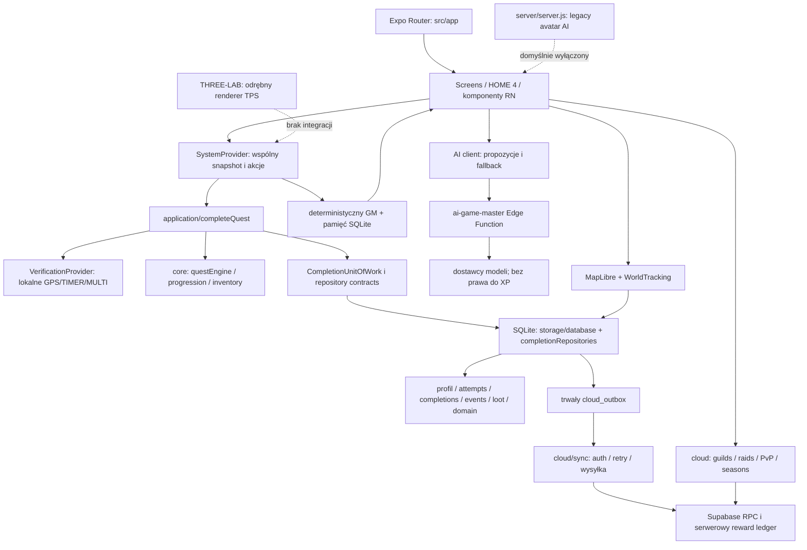

# SYSTEM — pełny audyt projektu przed SYSTEM WORLD 1.0

Data: **2026-11-02, Europe/Warsaw**. Tryb: **AUDIT FIRST**. Autor: audyt techniczny kodu, testów, historii i zasobów.

Projekt główny: `C:\SYSTEM\SYSTEM-RC2`. Branch: `prep/rc3-visual-reconstruction`. HEAD: `afcf9be361755cb56e43e8acf16561af4927bc91`. Początkowy stan Git: czysty. Nie zmieniono brancha, kodu aplikacji, zależności, migracji, podpisu ani danych. Rezultatem są ten raport i `docs/SYSTEM_WORLD_1_0_ROADMAP.md`; nie rozpoczęto implementacji.

## 1. Wniosek wykonawczy

SYSTEM ma wartościowy, zintegrowany **rdzeń offline-first Real Life RPG**: misje z weryfikacją, transakcyjne XP i loot, SQLite, checkpointy, Game Loop, kampanię GM, Living Domain, Living Gear i Tracebook. **Nie jest jeszcze pełnoekranową grą TPS 3D**. HOME jest kompozycją ilustracji i interfejsu, WORLD mapą MapLibre, a boss jest rozliczany przez wykonanie misji. Osobny THREE-LAB zawiera rzeczywisty prototyp TPS/dotyku/animacji proceduralnych, ale nie jest połączony z progresją SYSTEM.

W aktualnym uruchomieniu: **725/725 testów PASS**, 0 FAIL, 0 SKIP: aplikacja i skrypty 589, backend lokalny 105, THREE-LAB 31. TypeScript, kontrola składni legacy server, statyczny Play readiness i kontrola whitespace również PASS. Te wyniki **nie certyfikują Androida, wdrożonej chmury, wydajności ani grafiki na urządzeniu**.

Rekomendacja architektoniczna audytu: **Unity URP jako docelowy renderer pełnoekranowego WORLD, z obecną aplikacją jako hostem logiki, zapisu, sensorów i konta**. Najpierw trzeba zatwierdzić kontrakt własności danych, zamknąć bramki AI/save i wykonać ograniczony benchmark Android/bridge. To rekomendacja kierunku, nie twierdzenie o zmierzonej przewadze Unity. Nie ma podstaw do przepisywania całego SYSTEM ani do automatycznego zastąpienia RC3 przez THREE-LAB.

## 2. Metoda i granice dowodów

- **PASS** — kontrola wykonana w tym audycie, zakończona exit 0; zakres opisany przy wyniku.
- **HISTORICAL PASS** — stary raport/log; nie dowód aktualnego działania.
- **NOT TESTED** — nie wykonano właściwego testu, nawet jeśli istnieje kod lub specyfikacja.
- **FAIL** — aktualna, odtworzona awaria testu/komendy. W uruchomionych kontrolach produktu nie odnotowano FAIL. Luki znalezione statycznie są osobną kategorią, nie sfabrykowanym wynikiem testu.

Odczytano instrukcje `AGENTS.md`, inwentarz plików, konfiguracje, historię Git, dokumentację i reprezentatywne ścieżki wykonania. To przegląd architektury i ryzyk, nie formalny dowód poprawności każdej linii. Nie przeszukiwano zawartości `node_modules`, `.git/objects`, cache ani binariów buildów; odczyty konkretnych metadanych zależności, manifestów APK, wybranych nagłówków GLB i hashy były celowe. Nie uruchamiano instalacji, resetu, prebuild, deploy, migracji zdalnych, generowania assetów ani serwera AI.

Zakres rozszerzony: projekty/check-outy w `C:\SYSTEM`, THREE-LAB, THREE-TEST, CHARACTER-FACTORY; ograniczone wyszukiwanie Unity w `C:\SYSTEM` i `E:\SYSTEM`. Pozostałe duplikaty oceniono po metadanych/historycznych powiązaniach, bez udawania pełnego audytu każdej kopii. Nie odczytywano danych graczy, wartości sekretów ani konfiguracji live Supabase. Stan zdalnych branchy to lokalnie zapisane refs — bez fetch i potwierdzenia aktualności serwera.

Surowy rejestr **708 plików** przed utworzeniem raportów (z hidden, z wyłączeniami powyżej): `E:\SYSTEM\.tmp\system-full-audit\file-inventory.txt`. Logi audytu są poza repozytorium: `E:\SYSTEM\.tmp\system-full-audit\`.

## 3. Mapa istniejącej architektury



**Własność:** kanoniczne lokalne ukończenie: `application/completeQuest.ts:11`, `repositories/contracts.ts:17`, `storage/completionRepositories.ts`; adapter i serializacja transakcji: `storage/database.ts`. Efekty Story/Daily/Weekly są nadal częściowo sprzężone z SQL; nie cały backend gry jest czystą biblioteką domain. UI nie powinien tworzyć alternatywnej ścieżki nagród. Backend chmurowy osobno oblicza i deduplikuje nagrody; klient nie ma jeszcze kompletnego restore/reconciliation cloud → lokalny profil.

**Frontend:** `src/app/_layout.tsx:17` montuje Stack, provider i globalne overlays. Pięć głównych pozycji to HOME/QUEST/CHARACTER/WORLD/SOCIAL, nie natywne Tabs. Istnieją 45 adresów opisanych w handoff, 44 ekrany w `src/system2/screens`, dodatkowy HOME w `home4`; onboarding jest gate, nie osobną trasą. `src/components/app-tabs*` to pozostałość startera, nie główna nawigacja gry.

**Backend:** Supabase SQL/RPC + jedna Edge Function GM są aktywną architekturą kodu. `server/server.js` to osobny legacy generator avatarów, nie autorytatywny serwer rozgrywki. `vercel.json` publikuje `landing`, nie backend gry ani aplikację RN.

## 4. Inwentaryzacja katalogów i modułów

| Obszar | Inwentarz przed audytem | Faktyczne przeznaczenie |
|---|---:|---|
| `src` | 544 pliki | Router, UI, domena, zapis, cloud i testy |
| `assets` | 75 plików | 20 WebP, 21 PNG, SVG, 27 plików audio, 2 MP4, metadane |
| `supabase` | 36 plików | 26 migracji, Edge GM, testy/fixture/lockfile |
| `scripts` | 9 plików | Provenance/build/recovery APK, Play check, testy, reset startera |
| `server` | 3 pliki poza zależnościami | package/lock + legacy server |
| `docs` | 12 dokumentów | Historia konsolidacji, RC3, Android i handoff |
| `landing` | 4 pliki | index, privacy, JS, CSS; brak znalezionej osobnej strony usunięcia konta |
| `.github` | 8 plików | 7 workflow i szablon PR |
| `dist` | odczyt tylko istotnych artefaktów | 2 historyczne wydania APK + kopia beta, manifesty, task006 logi; cache pominięty |

Rejestr `src/system2` — liczby plików, nie deklaracja ukończenia funkcji:

| Grupa | Moduły i liczby |
|---|---|
| Rdzeń i zapis | core 8; application 1; repositories 1; storage 16; state 1; verification 10 |
| Pętla i kampania | gameLoop 17; gameMaster 15; director 1; adaptive 2; generation 2; ai 16 |
| Postęp i przedmioty | progression 14; inventory 3; achievements 10; identity 8; cards 4; companions 3 |
| Misje i aktywność | quests 14; daily 5; weekly 1; activity 4; move 20; goals 1; journeys 1; habits 2; planning 2 |
| Świat i prezentacja | world 10; domain 1; story 6; bosses 1; home4 9; presentation 18; visual 3; audio 2 |
| Online i rozszerzenia | cloud 21; social 44; sponsors 11; premium 2 |
| Aplikacja i bezpieczeństwo | screens 44; components 60; background 3; notifications 6; onboarding 2; launch 1; health 1; privacy 2; telemetry 3; diagnostics 5; beta 7; tester 1; i18n 1 |
| Weryfikacja i opis | tests 25 plików (w tym helpers/mock); ARCHITECTURE.md, CORE_AUDIT.md, MVP_QA.md |

### Historia, branche i inne checkouty

HEAD ma 1506 osiągalnych commitów. Zapisano 16 lokalnych branchy i 207 refs zdalnych (w tym symboliczny HEAD). Ostatnia linia rozwoju: RC2 build fixes `845475a`, `0e0bc6b`, `74201f1` → grafiki RC3 `7d3ff92` → Living Domain `483ddd3` → Gear/Tracebook `1eb3d1d` → beta source `e3218c0` → read models/handoff `afcf9be`.

| Lokalizacja / branch | Ustalony stan |
|---|---|
| `SYSTEM-RC2`, `qa/rc3-visual-device`, `ui/rc3-home-5` | wspólny `afcf9be`; różne worktree |
| `SYSTEM-core-integration`, `integration/game-loop-home-gm-4` | `bac48bd`; wcześniejsza integracja trzech paczek |
| `SYSTEM-ai-gm-home`, `feature/ai-gm-home-integration` | `258a6b4`; wcześniejsza pamięć/GM |
| `SYSTEM-home-world-4`, `feature/home-world-4` | `f1c288c`; wcześniejszy HOME |
| `SYSTEM-evening-build`, integration evening | `aa57e9a` |
| `SYSTEM-apk-build`, integration evening | `0930988`; osobny checkout/repo nie jest automatycznie aktualną bazą RC3 |
| `SYSTEM-RC1` | detached `bac48bd`; zachować |
| `feature/system-visual-assets`, `fix/android-gradle-configuration` | nie w pełni scalone lokalne branche; nie wykonywać automatycznego merge |
| `RC3-AUDIT`, `GROK-AUDIT/SOURCE`, `hardening-bundle`, backupy | materiały historyczne/snapshoty; nie zastępują bieżącego checkoutu |
| `THREE-LAB`, `CHARACTER-FACTORY` | osobne katalogi bez `.git` w korzeniu; nie są branchami aplikacji |

Lokalny `origin/master` ma wobec HEAD rozbieżność **1484 / 3** (`git rev-list --left-right --count HEAD...origin/master`). Nie wykonywać „synchronizacji do master” bez przeglądu historii; różnica jest duża i ref może być stary. Nie pobierano nowych refs.

`.git` głównego projektu jest plikiem worktree wskazującym `C:/SYSTEM/SYSTEM-evening-build-git-20260929/repository.git/worktrees/SYSTEM-RC2`. **Usunięcie tego repozytorium nadrzędnego grozi utratą metadanych/historii wszystkich powiązanych worktree.** Obejście kontroli ownership stosowano wyłącznie per-komenda `git -c safe.directory=...`, bez zmiany konfiguracji globalnej.

## 5. Macierz funkcjonalności i dojrzałości

Skala: **M0** pomysł/spec; **M1** izolowany prototyp/helper; **M2** implementacja lokalna lub kontrakt z testami; **M3** zintegrowana lokalna pętla i regresja; **M4** potwierdzone urządzenie + wdrożenie + operacje produkcyjne. M4 nie przyznano żadnemu modułowi na podstawie tego audytu. Poniższe PASS oznacza udział w bieżących zestawach, nie kompletny test urządzenia.

| System | Faktyczna implementacja i dowód | Potwierdzenie / braki | Dojrzałość; reuse / Unity |
|---|---|---|---|
| Game Loop | `state/SystemProvider.tsx:70,307`, `application/completeQuest.ts:11`, `gameLoop/rewardPlan.ts:5`: jeden completion i receipt, loot, prezentacja i next action | PASS: duplikaty, rollback, restart, kolejka prezentacji; Android NOT TESTED | M3; zachować całość, Unity tylko komendy/snapshoty |
| Misje | `quests`, `daily`, `generation`, `verification/localProvider.ts:5`: GPS_DISTANCE/TIMER/MULTI, dostęp/prerequisites i checkpointy | PASS lokalny; GPS i FGS/OEM na telefonie NOT TESTED; sensory nie są kryptograficznym proof | M3; reuse katalogów, ID i lifecycle |
| XP/statystyki/ranga | `core/progression.ts:9,72,82,115`, `core/questEngine.ts:31`; 7 skills, Equal Origin, real XP i skill XP | PASS; AI/renderer nie przyznaje XP | M3; read-only HUD Unity |
| Klasy/perki | `progression/perks.ts:4,16`, `CharacterScreen.tsx:99`: archetyp wyliczony ze skills, wpływa na rekomendacje GM | Nie ma pełnych wybieranych klas/aktywnych umiejętności; efekty combat częściowo niepodłączone | M2; potrzebna decyzja produktu przed rozszerzeniem |
| AI Game Master | `gameMaster/runtime.ts:23,104`, `storage/gameMaster.ts:13,36`: deterministyczny wybór, kampania v2, outcome memory, recovery/comeback; `ai/client.ts` i Edge osobno dają zewnętrzną narrację/propozycje | PASS runtime/persistence/fallback; Edge runtime/provider/live NOT TESTED; zgody i quota niekompletne | M3 deterministyczny / M2 cloud; przekazywać directives do Unity |
| Living Domain | `domain/storage.ts:8–31`: wersjonowany zapis w app_state, level = 1 + floor(unique completions/5), lokalizacje | PASS restart/corruption/duplikaty. COMMAND/ACADEMY/VAULT są wejściami do ekranów; FORGE/SANCTUARY LOCKED; brak przestrzeni 3D | M3 model / M0 świat; mapować stan na scenę, bez drugiego XP |
| Living Gear / inventory | `components/LivingGear.tsx:11`, `storage/database.ts:967–970`: kanoniczny loot, compare, equip/unequip; kosmetyki osobno w AsyncStorage | PASS z loot/restart; brak craftingu, item evolution, modeli i attachmentów 3D | M3; zachować instancje i statystyki, dodać wizualną mapę assetów |
| Tracebook | `inventory/tracebook.ts:14`, `database.ts:941`, `TracebookScreen.tsx:20`: read model rzeczywistych tabel, daty/filtry/dedup | PASS; brak fabrykowanych historycznych leveli; UI stronicuje po odczycie całej historii | M3 lokalnie; można pozostawić w RN |
| Shadow Rival | brak trafień nazwy `shadow.rival|shadow rival|shadowrival` w src/docs; `social/rivalries.ts` to drobne helpers | NOT TESTED; nie znaleziono kompletnego feature ani specyfikacji tej nazwy w badanym kodzie | M0 dla Shadow Rival / M1 helpers; osobne wymagania |
| Gildie/PvP/raids/sezony | `cloud/guilds.ts:17`, ekrany Guilds/BattleNetwork/Raids; SQL social battle, contribution i settlement | PASS kontrakty/SQL/RLS lokalnie; realne konta, matchmaking i wdrożenie NOT TESTED; lokalne lobby `/social` nie oznacza realnych członków | M2; zintegrowane API ponownie użyć, multiplayer 3D nie istnieje |
| Ekonomia | loot/XP/bonuses; `progression/energy.ts`, premium/sponsors contracts | spendEnergy niepodłączone; brak pełnej pętli wydatków/craftingu; vocabulary coins/chests nie dowodzi kanonicznej waluty; marketplace tylko kategorie | M2; żadnych real-money nagród na bazie samego sensor summary |
| Walka/Boss | `storage/story.ts:88` → `story/damage.ts:4`; etapy THE FIRST WALL i Daily damage, cinematic/HUD | PASS quest-driven boss; brak aktywnej walki TPS, hitboxów, AI przeciwnika i animacji walki | M3 quest boss / M0 action combat; nowa mechanika wymaga osobnego projektu |
| WORLD aplikacji | `WorldScreen`, MapLibre, `world/mapConfig.ts:1`, WorldTracking i SQLite sectors | PASS modeli/lifecycle w mockach; mapa używa demo tiles; nie jest rendererem prywatnej domeny 3D | M2; zachować eksplorację GPS oddzielnie od pozycji avatara |
| TPS/3D THREE-LAB | `C:/SYSTEM/THREE-LAB/src/game/{input,camera,character,animator}.js` | 31 PASS aktualnie; dotyk/TPS/klipy proceduralne; brak bridge, backendu i zapisu SYSTEM | M1/M2 laboratoryjnie; reuse scenariuszy, PBR, manifestów i benchmarku |
| Unity | dokumenty `THREE-LAB/docs/UNITY-*`, architektura jawnie SPEC ONLY | NOT TESTED; brak odnalezionego projektu/scen/C#/bridge/builda w zakresie wyszukiwania | M0; integracja dopiero do wykonania |
| Health/foto/QR/NFC | kontrakty health i lokalny private photo; brak dowodu native provider Health Connect/Apple Health | Private photo PASS w mockach; zdjęcie avatara nie jest dowodem XP; pozostałe metody nie są gotowymi providerami | M1/M2; nie dodawać fikcyjnych capabilities |

Istotne rozbieżności: `bossDamageMultiplier` (`progression/perks.ts:43`) i `applyBossPhaseDamage` (`story/bossEngine.ts:27`) są używane w definicjach/testach, ale nie w kanonicznym `story/damage.ts`. Opis DOUBLE_IMPACT nie dowodzi tygodniowego claim/cooldown. `spendEnergy` ma definicję bez podłączonego wydatku; nagrody zwiększają energię. Obecny badge/prezentacja nie potwierdza efektu w rozliczeniu gry.

## 6. Inwentaryzacja zasobów i laboratoriów

### Aplikacja RC3

- **20 WebP**, 14 007 260 B, 1080×1920; manifest `assets/visual/rc3/SYSTEM_RC3_ASSETS_20/manifest.json`. Bieżące testy potwierdziły unikalność/hashy. To upscale źródeł 941×1672, bez alfa według dokumentacji i metadanych; nie modele ani tekstury postaci 3D.
- **8 zarejestrowanych obrazów** w `src/system2/visual/assets.ts:3`: emblem, boot void/portal/world reveal/awakening, avatar neutral, private domain, character selection. Pozostałe 12 są zachowanymi materiałami, bez rejestracji w UI. Stare 48 WebP zostało wcześniej świadomie wycofane; nie przywracać ich automatycznie. Kategorie/boss/gear mogą celowo używać neutralnego fallbacku.
- **27 audio**: 15 MP3 = 54 398 218 B, 12 WAV = 21 847 953 B. Są m.in. home/world/quest/awakening/boss/victory i SFX; część alternatywnych utworów nie jest aktywnym cue. `audio/manifest.ts:14–38` rejestruje część jako techniczne placeholders; `audio/engine.ts:5` ma trzy busy music/ambient/sfx, fade i cleanup. Obecność utworu nie znaczy użycia ani potwierdzonej licencji komercyjnej; potrzebny rejestr praw i audyt pakowania. `home.wav` ma 15 797 472 B — kandydat do późniejszej optymalizacji po odsłuchu i pomiarze, bez kasowania źródła.
- `assets/video/system_boot.mp4` 145 764 B i `boss_intro.mp4` 145 170 B; zachować. Intro 2D/cinematic nie jest działającym światem 3D.
- 21 PNG, 1 SVG, JSON/TXT to m.in. ikony/splash/metadane. Nie znaleziono produkcyjnego szkieletowego avatara w głównym asset bundle.

### THREE-LAB i THREE-TEST

`C:\SYSTEM\THREE-LAB`: Vite + Three, modułowy świat wyspy/cytadeli/portalu, proceduralny humanoid i collision/ground, TPS, joystick, touch look/pinch, input keyboard i interakcje. LOW/MEDIUM/HIGH zmieniają DPR, cienie i cząstki (`src/game/quality.js:1`). Portal jest LOCKED, bez mapy docelowej. `C:\SYSTEM\THREE-TEST` jest pusty, również z hidden files.

| Zasób THREE-LAB | Potwierdzony stan |
|---|---|
| `assets/models/ruined-arch.glb` | 36 736 B; 372 trójkąty; 1 mesh/1 materiał; 0 skinów i animacji; własny generator, opis `docs/ASSET-LICENSES.md:41` |
| `assets/textures/*` | 9 JPG 1K: rock_boulder_dry / castle_brick_01 / aerial_rocks_01 × diffuse, normalGL, ARM; deklarowane CC0 Poly Haven, URL/authors w ASSET-LICENSES:7–35; aktualne testy hashy PASS |
| Wyspa/cytadela/ruiny/drzewa/portal/kryształy | geometria kodowa i materiały proceduralne/fallback, nie biblioteka gotowych modeli |
| Humanoid fallback | proceduralne części; realne klipy IDLE/WALK/RUN/TURN/INTERACT (`src/game/character.js:36`), jeden Mixer/crossfade (`animator.js:5`); TURN nie jest osobnym stanem kontrolera |
| Import avatara | `assets/models/character` zawiera README, bez player.glb i klipów; loader oczekuje SkinnedMesh, nie daje automatycznego retargetingu |
| VFX/światło | sky/fog/cloud/moon/stars, portal/crystal i bounded particles; brak HDRI; to kod Three wymagający portu do URP |
| Audio | brak plików i odtwarzania; wyłącznie hooki zdarzeń audio, `UNITY-INTEGRATION-CONTRACT.md:44` |

Testy Node nie renderują sceny na fizycznym GPU. Historyczne screenshot/browser/soak i web dist 7 733 053 B, JS gzip 200 499 B (`THREE-LAB-FINAL-BASELINE.md:17`) pozostają HISTORICAL PASS / historycznym pomiarem. Android FPS, temperatura, WebView i porównanie Unity: NOT TESTED.

### CHARACTER-FACTORY

| Plik względem `C:\SYSTEM\CHARACTER-FACTORY` | B | Trójkąty | Skins / animacje |
|---|---:|---:|---:|
| `master/M1_LEVEL1_MASTER.glb` | 22 645 604 | 1 975 414 | 0 / 0 |
| `exports/M1_LEVEL1_LOD0_70K.glb` | 13 841 352 | 69 998 | 0 / 0 |
| `exports/M1_LEVEL1_LOD1_50K.glb` | 13 299 400 | 49 998 | 0 / 0 |
| `exports/M1_LEVEL1_LOD2_30K.glb` | 12 745 000 | 29 998 | 0 / 0 |
| `M1_TPOSE/master/M1_TPOSE_MASTER.glb` | 21 679 192 | 1 972 964 | 0 / 0 |
| `M1_TPOSE/exports/M1_TPOSE_LOD0_70K.glb` | 12 988 908 | 69 998 | 0 / 0 |

Bieżący odczyt GLB: każdy 1 mesh/1 materiał/3 embedded obrazy. Mastery wymagają mesh quantization/meshopt; LOD nie deklarują tych wymaganych rozszerzeń. Są też FBX unrigged, pliki Blender, preview i PBR. Nazwy MIXAMO_READY/TPOSE **nie oznaczają riga ani animacji**. Potrzebne prawa do komercyjnego użycia, rig/weights, Idle/Walk/Run, test deformacji i importu. Dowody: `reports/CHARACTER-FACTORY-20.md:17`, `reports/M1-MIXAMO-READY.md:46`, `reports/M1-UNRIGGED-MIXAMO-UPLOAD.md:61`, `M1_TPOSE/reports/M1-TPOSE-70K-MIXAMO-READY.md:33–61`. Redukcja do 30K nie usuwa kosztu tekstur ani automatycznie nie robi wersji mobile-ready.

### Unity — zakres poszukiwań

Nie znaleziono `UNITY-LAB`, `SYSTEM-UNITY-LAB`, `ProjectSettings/ProjectVersion.txt` ani `Packages/manifest.json` w ograniczonym przeglądzie C:\SYSTEM i E:\SYSTEM z wyłączeniami zależności/cache/Library/Temp/dist; spacer do głębokości 4 objął 1174 katalogi. Nie oznacza to globalnej nieobecności Unity na komputerze. `THREE-LAB/docs/UNITY-BENCHMARK-IMPLEMENTATION-PLAN.md:12` mówi, że przyszłego projektu nie utworzono; `UNITY-PROPOSED-ARCHITECTURE.md:3` jest SPEC ONLY.

## 7. Audyt techniczny i bezpieczeństwo

### Zależności i Android

`package.json` + lockfile i `npm ls --depth=0 --offline` (exit 0): Expo **57.0.23**, RN **0.86.3**, React/DOM **19.2.3**, TS **6.0.3**, Router **57.0.21**, MapLibre **11.3.10**, Skia **2.6.2**, Reanimated **4.5.1**, Worklets **0.10.1**, SQLite **57.0.3**, SecureStore **57.0.4**, location **57.0.18**, task-manager **57.0.19**. Większość Expo używa `~`, część zewnętrznych `^`; faktyczny zestaw ustala lockfile. Lokalny metadata Expo potwierdza bazową parę Expo/RN/React i Worklets, lecz nie jest to kompletny test zgodności native.

THREE-LAB: deklaracje Three `^0.186.1`, Vite `^8.3.0`. Backend testów: PGlite **0.5.8**. Legacy server: Express `^5.2.1`, cors `^2.8.6`, dotenv `^17.4.2`, multer `^2.4.0`, openai `^7.17.0`; nie uruchamiano serwera ani instalacji jego zależności. Nie wykonywano skanu CVE: **NOT TESTED**, bez twierdzenia o braku podatności.

Środowisko audytu: Node **24.21.0**, Java **17**, Windows/PowerShell. CI używa Node **22** — odtwarzalność między wersjami wymaga późniejszej kontroli. `app.json`: pakiet **pl.systemworld.app**, wersja **1.0.1**, versionCode bazowy 2, portrait, lokalizacja background/FGS. Brak katalogu natywnego android w checkout; jest generowany w izolowanym buildzie. Brak `adb` w PATH w tym audycie; nie sprawdzano urządzenia. minSdk/targetSdk/ABI compatibility i wymogi sklepu nie są potwierdzone aktualnym buildem. Główny oficjalny launcher buduje arm64-v8a.

`npm ls` nie zgłosiło braków/invalid top-level. Nie uruchomiono `expo lint`: brak skonfigurowanego ESLint i lokalnej zależności, a ta komenda może proponować instalację. Obecne foldery node_modules przy RC2 i testach mają puste LinkType/Target; historyczna informacja o junctionach w E: nie została przyjęta jako aktualny fakt. Nie usuwać mimo to żadnych źródeł zależności bez osobnego sprawdzenia.

### Zapis i backend Supabase

1. Lokalny profil/loot/attempt/receipts są trwałe i transakcyjne. `cloud/sync.ts:43–103` ma outbox, retry i wiązanie konta; `:81–83` jawnie pozostawia SQLite jako źródło lokalnej gry. Brak kompletnej hydratacji/restoru i polityki konfliktów cloud → lokalny progres. Domain i Tracebook nie dodają synchronizacji między urządzeniami. Nie obiecywać odzyskania wszystkiego po reinstalacji.
2. Serwer wylicza reward, deduplikuje/replay-locks i zapisuje ledger (`20261001120000_safe_awakening.sql:287–308`). RPC sprawdza `auth.uid()` i pusty search_path (`:329`); whitelist/limit 16 KB i blokada raw GPS/photo w `:335–350`.
3. Migracje least privilege odbierają granty/EXECUTE PUBLIC (`20260919115000_client_api_least_privilege.sql:6–9,60–73`); prywatne adaptive tables mają RLS/revoke (`20260927090000_adaptive_sync_v1.sql:7`). PGlite potwierdza lokalne ścieżki RLS/RPC. Nie audytowano live advisorów, exposed schemas, wdrożonych grantów, Auth, Storage ani logów.
4. Podstawowe tabele dla testów pochodzą z `supabase/tests/fixtures/cloud-baseline.sql` (`processor.test.cjs:10–24`). Obecny katalog migracji sam nie dowodzi odtwarzalnego provisioningu pustej produkcji. Potrzebny test clean-room staging i porównanie migracji live bez ich automatycznego nakładania.
5. Nagroda server-authoritative nie oznacza niezależnego fizycznego proof: dystans/czas/score/verdict pochodzą z klienta (`safe_awakening.sql:48–57,156–167`). Są walidowane, ale nie ma dowodu sensor attestation. Publiczna konkurencja i sponsor payout wymagają osobnego threat model.
6. Auth native migruje sesję do SecureStore (`cloud/auth.ts:96–100`), refresh jest współdzielony, logout czyści finally (`:181–208`); web używa AsyncStorage. W kodzie klienta odnaleziono publishable config, service role jest używany po stronie Edge. Nie wykonano pełnego skanu sekretów całej historii Git; brak ujawnionych wartości nie jest certyfikacją braku sekretów.

### AI, prywatność i legacy API

| Priorytet | Ustalenie / dowód | Wymagany rezultat przed wydaniem |
|---|---|---|
| P1 | `privacy/consent.ts:1` ma aiCloud=false, lecz loadConsent/saveConsent nie mają wywołań w src; request `ai/runtime.ts:10`, `ai/story.ts:9` nie egzekwuje tej zgody | jawne egzekwowanie opt-in i cofnięcia; offline GM działa bez zgody |
| P1 | Edge wymaga Bearer/Auth (`functions/ai-game-master/index.ts:46–68`), ale handler `:515–555` nie ma aplikacyjnego quota/rate-limit, limitu body ani deadline provider fetch (`:411,416,468`) | limity per user/guest, budżet, deadline/cancel, ograniczony kontekst, testy nadużyć; limity platformy osobno sprawdzić |
| P1 | Daily ma lokalną bramkę ADULT, story nie ma równoważnej; Edge ufa kontekstowi player klienta; guestAuth może tworzyć anonimową sesję (`ai/guestAuth.ts:72`) | spójna polityka wieku/zgody na serwerze, bez polegania na modyfikowalnym kontekście klienta |
| P1 | `cloud/account.ts:29–50` zapisuje REQUESTED, brak workflow faktycznego usuwania Auth/danych; `privacy/export.ts` jest serializerem bez znalezionego podłączenia | działający deletion/export E2E i retencja; nie udawać gotowości samym przyciskiem |
| P1 gdy włączony | Legacy server default disabled (`server.js:15–25`); `/generated` publicznie statyczny poza `/api` guard (`:48–51,79–84`), zapis obrazów `:459–475`, listen all interfaces `:521` | pozostawić wyłączony; przed uruchomieniem ownership, prywatny storage/retencja i cost/rate limits |
| P2 | `world/mapConfig.ts:1` używa MapLibre demo tiles | własny dozwolony produkcyjny dostawca/cache/atrybucja i obsługa offline |

Nie stwierdzono incydentu wycieku. Są to luki egzekwowania i granice zaufania znalezione w kodzie. AI ma walidację i fallback, nie ma prawa nadawać XP (`Edge:397,431–447,478`); te bariery trzeba zachować przy integracji Unity. Prompt nie jest kontrolą uprawnień ani limitem kosztów.

### Wydajność i utrzymanie

- `database.ts:941–948` wczytuje całą historię Tracebook, dopiero UI stronicuje; `:968–969` equip zapisuje wszystkie inventory rows. To potencjalne koszty dużych profili, nie zmierzone lagi.
- `SystemProvider` i `storage/database.ts` skupiają wiele odpowiedzialności; nie rozdzielać ich masowo przed testem bridge. Wydzielone use case/ports stanowią bezpieczniejszą granicę.
- Obrazy 9:16 po dekodowaniu, długie audio, MapLibre i drugi runtime mogą zwiększać RAM/pakiet. Suma plików nie jest zużyciem RAM ani przyrostem APK; brak aktualnego profilu CPU/GPU/thermal.
- HOME ma bounded animacje i reduce-motion/LOW cleanup (`home4/README.md`); nie daje to dowodu wydajności Unity/3D. Three ma presety i disposal testy, ale brak Android benchmarku.
- TS wyklucza `supabase/functions/**/*.ts` (`tsconfig.json`): PASS aplikacji **nie sprawdza typów Deno Edge Function**. Brak pomiaru procentowego coverage, testów runtime Edge/provider, produkcyjnego E2E i pełnej automatyzacji urządzenia.

## 8. Build i podpis APK

`scripts/official-apk.cjs:15` wymaga czystego wskazanego commita, istniejącego podpisu/certyfikatu i SDK; robi `git archive`, npm ci, Expo prebuild i Gradle release w osobnym katalogu, sprawdza embedded metadata/bundle, applicationId/version i certyfikat; publikuje EXCL z JSON/hash. Nie generuje zastępczego klucza i nie nadpisuje APK.

`app.config.js` odrzuca direct EAS i wyłącza OTA. Dozwolone źródła w `scripts/apk-provenance.cjs:3–20` obejmują evening-build, konkretny RC1, RC2 i RC3 integration. **prep/rc3-visual-reconstruction nie jest dozwolony**. Nie zmieniać allowlisty dla obejścia. `official-apk.yml` ogranicza CI do evening-build; nie obsługuje obecnego prep jako oficjalnego release.

Istotny brak: launcher po npm ci **nie uruchamia TypeScript ani całej regresji przed Gradle/publikacją**, a workflow official uruchamia tylko provenance tests. Oddzielne `system-ci.yml` ma większą regresję, ale jego filtry branchy nie gwarantują checks dla `prep/**`. Inne workflow mają własne filtry. Potrzebna jedna wymagana bramka testów dla dokładnego SHA przed podpisaniem/dystrybucją. `eas.json` i `GOOGLE_PLAY_READINESS.md` nadal opisują EAS/AAB, choć app.config go blokuje — udokumentowany proces sklepu jest niespójny i niepotwierdzony.

| Lokalny historyczny artefakt | Manifest / aktualny odczyt |
|---|---|
| `dist/official/845475a...-cda4b7a5-...` | deklaruje fix/rc2-build-readiness, SHA 845475a..., v1.0.1, code 213102153; build z 2026-10-02 |
| `dist/official/e3218c0...-dc80fed2-...` | deklaruje integration/rc3-awakening-world, SHA e3218c0..., v1.0.1, code 213171610; build z 2026-10-03 |
| `dist/rc3-device-beta/SYSTEM-RC3-DEVICE-BETA.apk` | aktualny SHA256 `cd4b35bbac96dfd065811977761ff8eb807986d88f3706648fa06d06958703e9` zgadza się z manifestem wydania e3218c0 |

To aktualne sprawdzenie pliku i deklaracji manifestu, **nie ponowna weryfikacja podpisu APK, instalacji telefonu ani zgodności APK z HEAD afcf9be**. Nie budowano i nie instalowano APK, nie odczytywano kluczy. Chronić applicationId, podpis i kompatybilność aktualizacji; nie odinstalowywać aplikacji w celu obejścia problemu podpisu.

## 9. Wyniki testów wykonanych teraz

Wszystkie komendy z projektu RC2, chyba że zaznaczono inaczej. Nie pobierano zależności. Mocki sieci nie dotykały produkcji.

| Kontrola | Status i zakres | Dowód |
|---|---|---|
| `node node_modules/typescript/bin/tsc --noEmit --incremental false` | **PASS**, exit 0 | `E:/SYSTEM/.tmp/system-full-audit/typecheck.log` (pusty stdout, exit odnotowany w wyniku narzędzia) |
| `node --test --test-reporter=tap src/system2/tests/gameplay.test.cjs` | **PASS 322/322**, 0 skipped, exit 0, 171428.97 ms | `.../gameplay.log` |
| Pozostałe 22 `src/system2/tests/*.test.cjs` + 3 `scripts/*.test.cjs`, bez gameplay, concurrency=1 | **PASS 267/267**, 0 skipped, exit 0, 76125.86 ms | `.../app-other.log` |
| `node --test processor.test.cjs mobile-sync.test.cjs social-contract.test.cjs calendar-fixtures.test.cjs`, cwd supabase/tests | **PASS 105/105**, exit 0, 19356.28 ms | `.../backend-summary.txt`: zapis wyniku narzędzia, pełnego stdout nie archiwizowano |
| `node --test tests/*.test.js`, cwd THREE-LAB | **PASS 31/31**, exit 0, 633.48 ms | `.../three/node-tests.log` |
| `node scripts/check-play-readiness.mjs` | **PASS**, exit 0; tylko statyczna checklista config/disclosure/assets/privacy | wynik narzędzia; nie certyfikat sklepu |
| `node --check server/server.js` | **PASS**, exit 0; tylko składnia | wynik narzędzia |
| `npm.cmd ls --depth=0 --offline` | **PASS**, exit 0; lokalne top-level dependencies | `.../dependencies.log` |
| `git diff --check` | **PASS**, exit 0 | wynik narzędzia; ponowione przy zapisie raportów |

Łącznie **725 unikalnych testów** w rozłącznych zestawach. Pomocnicze kontrole powyżej nie są dodawane do liczby testów. `server/package.json` ma placeholder npm test z exit 1 — nie uruchomiono go jako realnej regresji i nie podano fałszywego PASS.

Odtworzenie pozostałych testów PowerShell bez zmian plików:

```powershell
$cases = Get-ChildItem src/system2/tests -Filter *.test.cjs |
  Where-Object Name -ne 'gameplay.test.cjs' | ForEach-Object FullName
$scriptCases = Get-ChildItem scripts -Filter *.test.cjs | ForEach-Object FullName
node --test --test-reporter=tap --test-concurrency=1 @cases @scriptCases
```

Testy gameplay używają realnego Node SQLite, częściowo plikowego restartu, ale transpilują kod do VM i mockują React Native, GPS, obrazy, audio i scheduling. PGlite ładuje fixture baseline i migracje, sieć mobilna jest mockowana. Nie utożsamiać tego z testem Androida/PostgREST/Edge.

**NOT TESTED:** fizyczny Android (render, proces killed/restart, screen lock, GPS, FGS, bateria), native release build HEAD, podpis aktualnego builda, AAB/Play, CI na serwerze, live Supabase/migration drift/Storage/Auth, runtime Edge i provider AI, restore między urządzeniami, GPU/FPS/RAM/thermal, Unity i jego bridge, browser runtime THREE w tym audycie, CVE, procent coverage.

**HISTORICAL PASS:** `dist/task006-gameplay-tests.log` 322; `task006-mobile-tests.log` 589 (zawiera gameplay, nie sumować ich ponownie); `task006-cloud-tests.log` 105. `CORE-INTEGRATION-4-REPORT.md` 663 dla starszego zakresu; Living Gear report 361, Graphics report 394; scorecard THREE z 2026-10-05 ma Unity NOT TESTED. Dawne wyniki nie zastąpiły obecnych uruchomień.

## 10. Rejestr dokumentacji i aktualność

Wszystkie poniższe ścieżki są względem RC2, jeśli nie zaznaczono inaczej. Dokumentacja opisuje wiele etapów; kod i bieżący dowód mają pierwszeństwo przy konflikcie.

| Dokument | Wartość / ograniczenie |
|---|---|
| `AGENTS.md`, `CLAUDE.md`, `.github/pull_request_template.md` | invariants, bezpieczny workflow; CLAUDE odsyła do AGENTS |
| `README.md` | szablon Expo, zawiera instrukcję reset-project; nie jest instrukcją produkcji SYSTEM |
| `CORE-INTEGRATION-4-REPORT.md` | integracja pętli/GM/HOME, jawne partials, historyczne wyniki |
| `src/system2/ARCHITECTURE.md` | cenne use case/ports; sekcje „future cloud/AI” i stare błędy TS są starsze od aktualnej integracji |
| `src/system2/CORE_AUDIT.md` | 2026-09-18, historyczny stan; brak social/backend w tym raporcie nie opisuje RC3 |
| `src/system2/MVP_QA.md` | zawiera historyczne checklisty i późniejsze aktualizacje; nie stosować wszystkich dawnych braków do HEAD |
| `src/system2/home4/README.md`, `gameMaster/INTEGRATION-4.md` | kontrakty HOME/directives i kampanii; część wcześniejszych ograniczeń została później scalona |
| `docs/ANDROID_BETA_PHONE_TEST_2026-09-23.md` | checklista urządzenia, nie wykonane testy aktualnego APK |
| `docs/BETA-STABILIZATION-1.0.md` | historyczna naprawa calendar fixture normalizer; bieżące testy lokalne PASS |
| `docs/CANONICAL_CONSOLIDATION.md` | historia scalania E: i wykluczonych prototypów; stare ścieżki/junction nie są aktualnym config |
| `docs/CLOUD_CANONICAL_COMPATIBILITY.md` | katalog/server authority i historyczne lokalne SQL tests, nie deployment |
| `docs/GOOGLE_PLAY_READINESS.md` | lista wymogów do ponownej walidacji; stare wersje 1.0.0/1 i EAS niespójne z aktualnym app.config |
| `docs/OFFICIAL_APK_SOURCE.md` | cenne zasady pochodzenia/podpisu; opis jednej branch evening jest starszy od RC2/RC3 allowlist |
| `docs/RC3-GRAPHICS-INTEGRATION.md` | aktualne rozróżnienie 20 zachowanych / 8 aktywnych ilustracji, retired art |
| `docs/RC3-LIVING-DOMAIN-1.md` | trwały model domeny i granice LOCKED/lokalności; historyczne PASS |
| `docs/RC3-LIVING-GEAR-TRACEBOOK-1.md` | wyposażenie/history i ograniczenia cross-device/paginacji; historyczne PASS |
| `docs/RC3-VISUAL-RECONSTRUCTION-HANDOFF.md` | najbliższa HEAD mapa 45 tras, read models i pochodzenie beta APK; błędne dziś zdanie o nieistniejącym E: jest historyczne |
| `docs/SYSTEM_UNIFIED_FINAL_2026-09-27.md` | proweniencja merge i granice sensor/cloud, nie aktualna certyfikacja |
| `docs/VISUAL-INTEGRATION-1.0.md` | stare 48 WebP/15 avatarów; świadomie zastąpione pakietem RC3, nie przywracać z rozpędu |

Dokumenty THREE-LAB: README; PROTOTYPE-PLAN/REPORT, PROTOTYPE-02-REPORT, PROTOTYPE-03-{PLAN,DESIGN,LEDGER,REPORT}; THREE-LAB-FINALIZATION-REPORT/FINAL-BASELINE; ASSET-LICENSES; PLAYER-CHARACTER-REQUIREMENTS; ENGINE-BENCHMARK-SCORECARD; UNITY-{WORLD-MANIFEST,PROPOSED-ARCHITECTURE,INTEGRATION-CONTRACT,GAMEPLAY-CONTRACT,FREE-ASSET-REQUIREMENTS,BENCHMARK-IMPLEMENTATION-PLAN}. To istniejący materiał wejściowy do benchmarku i portu, **nie wykonany projekt Unity**. README w assets/environment/audio/character opisują m.in. brakujące zasoby. Raporty CHARACTER-FACTORY przeanalizowano dla pochodzenia, eksportu, riga i licencji; ich historyczna walidacja Blendera nie została tu ponownie uruchomiona.

## 11. Porównanie silników i rekomendacja WORLD 1.0

| Kryterium | Three.js | Unity URP | Hybryda RN + Unity URP |
|---|---|---|---|
| Stan istniejący | działający osobny prototyp TPS/touch | wyłącznie spec/kontrakty | brak bridge/native integracji |
| Najkrótszy pokaz 3D | najmniejszy koszt, istniejący kod | wymaga projektu i portu sceny | dodatkowo lifecycle/Gradle/bridge |
| Reuse logiki SYSTEM | TS łatwiejszy, ale obecny lab i RN nie są jednym runtime/UI; WebView też wymaga adaptera | TS/hooki nie wykonają się bez portu/runtime | zachowuje TS/SQLite/FGS w host; Unity renderuje |
| Animacje/asset pipeline | obecny Mixer/proceduralne klipy; retargeting i tooling do zbudowania | odpowiedni ekosystem Animator/rigging/LOD/profilera; trzeba dostarczyć assety | te same zalety i koszty Unity + mostek |
| Android | WebGL/browser/WebView NOT TESTED | natywny Android NOT TESTED dla SYSTEM | 2 runtime, RAM, audio i lifecycle to główne ryzyka |
| Rozwój pełnego RPG 3D | wykonalny, wymaga dużo własnego gameplay/toolingu | preferowany kierunek dla większego świata i authored animacji | pozwala zachować obecny rdzeń; koszt integracji niezmierzony |
| Zmierzony FPS/koszt/godziny | tylko historyczne pomiary desktop web | brak | brak; nie deklarować przewagi |

**Wybór rekomendowany:** hybryda z Unity URP dla WORLD, z warunkiem przejścia benchmarku. RN nadal obsługuje konto, prywatność, misje real-life, sensory, zapis, aktualny UI; Unity pełnoekranowo prezentuje domenę, postać, interakcje i HUD. Nie zastępować MapLibre pozycją avatara. Nie przenosić do C# obliczania REAL XP, ledgerów i całej bazy przy pierwszym wdrożeniu.

Proponowana granica (nowa, jeszcze niezaimplementowana): wersjonowane DTO snapshot/directives/receipt i komendy z commandId + playerId/profile generation + expected revision. Host ma walidować aktualnego gracza i wykonywać istniejący use case; ACK/odświeżony snapshot dopiero po commit. Retry tej samej komendy nie może dać drugiej nagrody. Unity nie może zapisywać SQLite, otrzymywać service role ani przyjmować nagród od LLM. Zmiana konta/restart musi unieważniać stare odpowiedzi. Dane ruchu 3D mogą być lokalne wizualnie; nie są dowodem realnego GPS ani drogą do REAL XP. Nie wywoływać bridge co klatkę.

Uzasadnienie zewnętrzne, sprawdzone 2026-11-02: [Unity as a Library — Android](https://docs.unity.com/en-us/engine/6000.0/manual/platform-specific/android/developing/unityasa-library) opisuje integrację unityLibrary, sterowanie lifecycle i wsparcie pełnoekranowe; wymaga to pracy nad pluginami/Gradle. [URP performance](https://docs.unity.com/en-us/engine/6000.7/manual/analysis/graphics-performance-profiling/in-urp/understand-performance/understand-performance) zaleca pomiar CPU/GPU/pamięci. [Three responsive rendering](https://threejs.org/manual/pages/responsive.html) omawia koszt rozdzielczości na mobile, [shadows](https://threejs.org/manual/pages/shadows.html) dodatkowe przebiegi. To nie są wyniki SYSTEM. Zasady oceny SQL porównano z [Supabase functions](https://supabase.com/docs/guides/database/functions) i [RLS](https://supabase.com/docs/guides/database/postgres/row-level-security); próba odczytu changelog.md nie zwróciła treści w narzędziu, więc nie potwierdzono kompletnego przeglądu breaking changes.

## 12. Problemy i bramki przed dalszą produkcją

1. **P1 — własność zapisu i restore:** brak kompletnej polityki offline/cloud/Unity, odzyskiwania po reinstalacji i reconciliation. Nie wolno tworzyć drugiej progresji w rendererze.
2. **P1 — AI:** zgoda, polityka wieku, quota/rate limit/body/deadline wymagają egzekwowania na właściwych granicach. Nie uruchamiać masowej generacji przed zamknięciem kosztów.
3. **P1 — bezpieczeństwo wydania:** obecny branch nie jest release source; oficjalny build nie wymusza pełnej regresji dokładnego SHA; zachować podpis i dane.
4. **P1 — brak dowodu urządzenia i deploymentu:** build/device/cloud staging gates przed beta WORLD, nie po rozbudowaniu świata.
5. **P1 — postać:** brak legalnie zatwierdzonego rigged avatara i Idle/Walk/Run dla modelu produkcyjnego.
6. **P1 przed publikacją — deletion/export/retencja:** request konta nie jest wykonanym usunięciem, serializer nie jest gotowym eksportem.
7. **P2 — combat/perki/energia/klasy:** opisy nie pokrywają części kanonicznych efektów; ustalić scope przed projektowaniem UI/animacji walki.
8. **P2 — content i optymalizacja:** Forge/Sanctuary/Shadow Rival/aktywna walka/multiplayer 3D nie są gotowymi systemami; obrazy RC3 nie zastąpią modeli, a procedury Three nie importują się bezpośrednio do URP.
9. **P2 — operacyjność:** clean-room migracje, Edge runtime tests, wymagane CI, Play AAB pipeline, aktualny runbook i licencje map/audio.

Nie przypisano P0 bez dowodu incydentu lub blokującej aktualnej awarii. P1 oznacza bramkę odpowiedniego wydania, nie nakaz natychmiastowego zmieniania produkcji w ramach audytu.

## 13. Elementy chronione — nie nadpisywać i nie usuwać

- Wszystkie istniejące zapisy SQLite, profile, inventory instance IDs/acquiredAt, quest_completions, verified_events, protocol bonuses, checkpoints/attempts, outbox i receipt cursors. Brak resetu, automatycznego nowego profilu albo reinstalacji jako metody naprawy.
- Historyczne migracje SQLite/Supabase, unikalne klucze i invariants: Equal Origin, STR/VIT/INT/WIL/CHA/CRE/RES, Quest → Proof → Verify → Reward, brak sprzedaży REAL XP. Zmiany tylko forward i po review.
- `application/completeQuest.ts`, `repositories/contracts.ts`, transakcyjny adapter i istniejące testy replay/rollback/restart — nie zastępować bez uzasadnienia i dowodu równoważności.
- `domain/storage.ts`, kampania v2, Living Gear i Tracebook oraz nowe read models z `afcf9be`; nie cofać do starszego HOME/canonical checkout tylko dla wyglądu.
- `assets/video/system_boot.mp4`, boss intro, oryginały RC3 i manifesty/proweniencja; brak automatycznej zamiany assetów lub ponownego wprowadzenia retired RC2.
- Istniejący applicationId, klucz podpisu i certyfikat; nie generować zamiennika, nie wypisywać wartości sekretów.
- `dist/official`, APK/JSON/SHA256 i beta copy jako historyczny punkt odniesienia; nie nadpisywać jako latest.
- Wszystkie branche, worktree, backupy, `SYSTEM-evening-build-git-20260929/repository.git`, `GROK-AUDIT`, `RC3-AUDIT`, repozytoria E: i źródła CHARACTER-FACTORY/Blender/FBX/LOD. Brak zgody na sprzątanie w tym audycie.
- THREE-LAB baseline i artefakty pomiarowe, kontrakty Unity, licencje/URL/hash zasobów.

## 14. Decyzje do zatwierdzenia i następny krok

Do zatwierdzenia przed implementacją: (1) RN host + Unity URP jako kierunek benchmarku; (2) docelowe urządzenia, orientacja i bramki wydajności; (3) granica REAL XP vs interakcje 3D i właściciel zapisu; (4) polityka guest/offline/cloud restore; (5) wersja Unity LTS/licencja i budżet assetów; (6) wybór legalnego avatara/rig/animacje; (7) polityka AI/małoletnich/budżetu; (8) minimalny scope WORLD bez pozornego craftingu/Shadow Rival/walki; (9) autoryzowany branch/release/AAB/signing/rollback; (10) osobny staging i dopiero później zatwierdzone migracje produkcyjne.

**Następny krok:** przegląd tego raportu i roadmapy, zatwierdzenie etapu zabezpieczenia baseline oraz kontraktu danych, następnie ograniczony spike/benchmark RN ↔ Unity na fizycznym Androidzie. Nie rozpoczynać pełnej produkcji świata przed dowodem, że nowy renderer zachowuje istniejący zapis, nagrody i GPS przy przejściu między runtime.

Plan etapów, kryteria odbioru i pierwsze 10 zadań: `docs/SYSTEM_WORLD_1_0_ROADMAP.md`. **Audyt kończy się tutaj; implementacja nie została rozpoczęta.**
